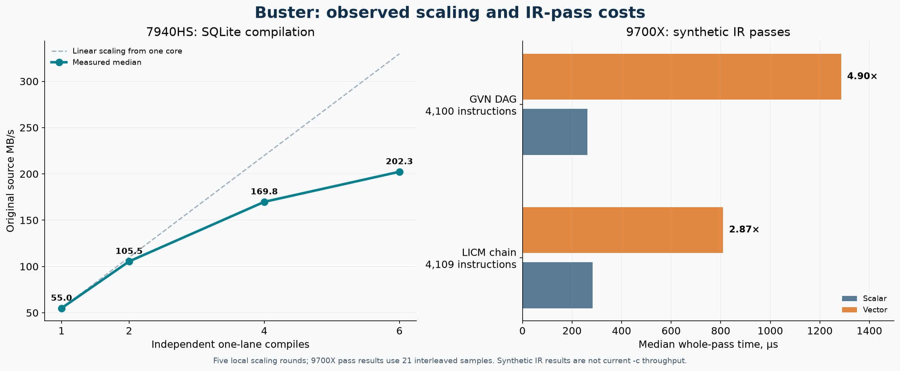

# Buster microarchitecture investigation, 29 October 2026

This record compares a local Ryzen 9 7940HS (Zen 4) investigation with Ryzen 7 9700X (Zen 5) measurements. The compiler source baseline is `586c2ae2e40f117f27330307944a6d64566e0882`; the [9700X main CI run](https://github.com/buster14a/buster/actions/runs/40896558391/job/123560758929) built and tested that exact revision. A separate [9700X counter campaign](https://github.com/buster14a/buster/actions/runs/40905168950) uses workflow-only commit `7b00a9da1a195a5ac8b47dc13dfe72ad268a0568`, whose parent is the baseline; it changes no compiler source. Its outcome is recorded separately below.

The common driver input is frozen SQLite, 9,507,037 bytes, SHA-256 `0a409f1633283fa31a9126b11fbfd64a1991c5d30defad07e5745d4667f5e23d`, with the project's frozen headers and predefines. The local driver experiments use default SQLite features, `-std=gnu17 -march=znver5 --clang-features`, and the commands in `local/commands.json`; original source bytes are the throughput denominator. `-c` includes compiler startup, Tier 0 object generation, buffered writes and process exit, but excludes final linking and `fsync`. CI sub-benchmarks may use different options or synthetic inputs.

The [large-evidence release](https://github.com/buster14a/buster-performance/releases/tag/microarchitecture-2026-10-29-ed07c05b) preserves the exact local executable, raw compressed profiles, licenses and the complete local record. Its local archive has SHA-256 `8ed22e39642ba1831e3157af7444421dc4971607b115815dc3cc1e743931722e` and contains a per-file hash manifest. Frozen inputs are independently identified by the project's verified corpus manifest.

The local machine has eight Zen 4 cores, two threads per core, 32 KiB L1 data cache and 1 MiB L2 per core, and a shared 16 MiB L3. The previously recorded 9700X has eight Zen 5 cores, 48 KiB L1 data cache and 1 MiB L2 per core, and a shared 32 MiB L3; one SMT sibling was offline in that record. Their governors, cooling, operating systems and compiler-build debug settings differ, so this is not a controlled measurement of architectural speedup. The measured compiler working set is far larger than either last-level cache; the counters below support investigating data lifetime and memory traffic, while they do not establish a unique causal bottleneck.

## Local 7940HS: whole compilation

Clang 23.1.4 built the local compiler using `./build.sh` defaults: `-O3 -march=native`, with debug information. `local/build.log` and `local/environment.json` record the executable hash and host. CPU 2, with SMT sibling 10, was allocated through `cores` for single-core records. The governor was `powersave`, boost was enabled, and transparent huge pages were `always`. This live desktop is not an isolated or fixed-frequency qualification machine. Six physical cores were available under the owner's existing reservation. Local numbers are diagnostic; optimization acceptance belongs on the locked 9700X.

| Independent one-lane compiles | Median MB/s | Five-run range MB/s |
| --- | ---: | ---: |
| 1 physical core | 54.96 | 54.43–57.43 |
| 2 | 105.48 | 103.85–106.58 |
| 4 | 169.81 | 168.75–170.29 |
| 6 | 202.33 | 199.02–203.74 |

The five rotated rounds each complete four objects per worker, pinned one worker per physical core. All 20 batches and 260 object compilations succeeded, and every object had the same hash. Six cores give 3.68 times the one-core rate. This is aggregate throughput over independent copies of one source file, not the latency of one compile. `/dev/shm` held the output objects. Per-child resource data are in `local/scaling.jsonl`.

On a different six-core cohort of 96 compilations, system-wide UMC counters counted 1,169,224,982 read and 637,401,908 write CAS commands. Using the Linux UMC convention of 64 bytes per CAS gives about 115.6 GB, or 126.7 bytes per source byte, over a 4.67 s counter interval. The package counter reported 196.92 J. An immediately separate 5.00 s idle control counted about 10.9 GB of UMC traffic and 58.38 J. Both include background processes, graphics and kernel activity; they cannot be assigned solely to Buster or blindly subtracted as exact attribution. A six-core integer streaming calibration reached medians of 40.96 GB/s with cached stores and 41.03 GB/s with non-temporal stores. Those are *logical* array bytes, not UMC physical bytes; they do not establish a saturation fraction.

Seven fresh-process `--time-stages` runs have a median 169.22 ms compiler stage span (163.14–175.23 ms):

| Stage | ms | Approximate share of 169.22 ms |
| --- | ---: | ---: |
| Preprocessing | 14.29 | 8.4% |
| Parsing | 8.65 | 5.1% |
| Semantic input construction | 68.33 | 40.4% |
| Expression checking | 15.65 | 9.2% |
| Declaration checking | 5.01 | 3.0% |
| Program checking | 14.37 | 8.5% |
| Lowering | 24.39 | 14.4% |
| Tier 0 | 6.46 | 3.8% |
| Branch sizing and encoding | 1.31 combined | 0.8% |

Medians are taken independently; they should not be added as if from the same execution. Per-run reports are retained in `measurements.jsonl`, and `stages-summary.csv` gives ranges. Reported process peak RSS had a 389,136 KiB median, but the parent-footprint experiment below shows that `ru_maxrss` can include pre-exec memory. Check the launcher before interpreting it as executable-only peak memory.

A separate seven-pair local run alternated the normal and `--scalar` reference paths. Median driver-stage spans were 194.96 and 312.80 ms, with byte-identical objects. The switch changes reference algorithms as well as scalar implementations; this is not a pure vector-width comparison. The earlier stage cohort ran at a different time.

## Counter and sampling evidence

`perf list` exposed 358 named local per-thread CPU event entries. Each was attempted for preprocessing, syntax checking and compilation, with two repeats and same-execution user cycles and instructions. Four events plus the two anchors fit most groups. Two groups multiplexed below 99%; their eight events were remeasured individually with two repetitions. All 358 names therefore have at least two fully scheduled results for each workload. Some entries are aliases; successful scheduling does not validate every event's physical interpretation. `local/perf-list.json` retains encodings and descriptions, `local/measurements.jsonl` and `local/recovery.jsonl` contain original outputs, and `local/counters-summary.csv` normalizes only records with at least 99% duty.

All 143 exposed derived core metric names were attempted separately for each workload. For each workload, 101 returned finite values with at least 99% counter duty, 34 failed and eight had no finite reported value. The failures and unavailable values remain in the raw records; several are uncore metrics that cannot be collected per thread. `metrics-summary.csv` is an index, not proof of event validity. See [Linux perf's event-group documentation](https://man7.org/linux/man-pages/man1/perf-list.1.html) and [AMD's PMC overview](https://docs.amd.com/r/en-US/57368-uProf-user-guide/1.2.1.-Performance-Monitor-Counters-PMC).

For the local `-c` cohort, independently measured user-only metric executions reported 42.6% of dispatch slots backend-bound, including 35.7% attributed to memory and 7.2% to other backend causes; frontend-bound was 15.9%, bad speculation 8.5%, and retiring 32.8%. They are separate process runs, so their rounded values do not form an exact partition. The main baseline, including user and kernel, retired a median 1.347 billion instructions in 821.5 million cycles (1.64 instructions/cycle), with 4.08 million branch misses across 218.1 million branches (1.87%). Scope and denominators differ from the user-only metrics.

A 30-compile local user-cycle sample attributed 10.81% to `check_input_expressions`, 5.70% to `check_input_resolve_range`, and 3.67% to `check_lower_drain`. A separate user-plus-kernel sample attributed 9.50% to kernel `get_page_from_freelist.cold`, reached from huge-page allocation paths. Each had about 5,000 samples and reported zero loss. An independent operation-count IBS sample recorded 421,000 samples with no reported loss or timestamp disorder. Within compiler-image samples with an identified data source, 163,678 were labelled L1 hits, 3,104 L2 hits, 106 L3 hits, and 540 RAM hits. This is an IBS sample population, not a global cache-hit ratio or an additive wall-time budget. Branch-stack and IBS-fetch captures are also retained. See `local/profiles*`; the exact local executable and compressed samples are preserved with the large-evidence archive.

## Ryzen 7 9700X: current source and historical context

The exact-source [main CI run](https://github.com/buster14a/buster/actions/runs/40896558391/job/123560758929) passed both hosted correctness configurations, native vector correctness and the native benchmark job. It used Clang 23.1.4 and an optimized `-march=znver5` host build without debug information. `zen5/main-ci-job.log` retains the job output. Its `benchmark-ir-optimize-passes` fixture measures public IR passes, **not** the current `-c` driver:

| 9700X synthetic fixture, 21 interleaved samples | Scalar median | Vector median | Vector/scalar |
| --- | ---: | ---: | ---: |
| GVN, 4,100-instruction large DAG | 262.54 µs | 1,286.35 µs | 4.90× |
| LICM, 4,109-instruction invariant chain | 282.54 µs | 809.63 µs | 2.87× |

For the GVN DAG both paths removed 1,024 instructions, but the cyclic-phi fixture shows that vector GVN can remove additional congruent values; a blanket scalar fallback would change optimization quality. The LICM paths moved the same 4,096 instructions and its benchmark checks exact output. Three local processes per 1,024/4,096 case reproduce the same direction; the 4,096 cases range 3.94–4.05× for GVN and 2.36–2.44× for LICM. These synthetic results establish pass-level opportunities, not a current end-to-end regression or corpus-wide benefit.

The [previous 9700X campaign](https://github.com/buster14a/buster-performance/blob/e2377fd2d3d01e8c89efc8b68e7b2acc3444e7bd/docs/measurements/microarchitecture-9700x-2026-10-27/analysis.md) measured source `92c025e7` and different SQLite options: 187.53 MB/s across eight physical cores, 268.74 system-wide UMC bytes per source byte, and about 51.62 GB/s of UMC traffic. It also found exposed data-fabric bandwidth aliases disagreed with UMC controls on this client CPU. These numbers are historical context, not directly comparable current-revision results. Its [method](https://github.com/buster14a/buster-performance/blob/e2377fd2d3d01e8c89efc8b68e7b2acc3444e7bd/docs/measurements/microarchitecture-9700x-2026-10-27/method/README.md) documents its event sweep, derived metrics, IBS and branch samples, UMC controls and validation.

The separate [9700X counter campaign](https://github.com/buster14a/buster/actions/runs/40905168950) completed successfully after both hosted configurations and native vector correctness passed. It used the same compiler binary hash `cff83eaeaca04d4c34d444405fa16227a2937a31fdb3d5afb6120a27cee88d42` as the main CI job, and the same input identities as the local sweep. Its seven instrumented `-c` runs on CPU 2 had a median 125.35 ms driver span: preprocessing 9.63 ms, parsing 7.18 ms, semantic input construction 55.48 ms, expression checking 11.32 ms, program checking 11.81 ms, lowering 14.93 ms and Tier 0 4.82 ms. Independently collected baseline counters, including user and kernel, gave median 1.337 billion instructions, 695.9 million cycles (1.92 instructions/cycle) and 3.63 million branch misses among 216.1 million branches (1.68%). Median reported peak RSS was 383,664 KiB; the inherited-peak limitation below still applies.

Individually collected user-only derived metrics for this 9700X compile reported 41.4% of dispatch slots backend-bound, 23.8% frontend-bound and 25.1% retiring; perf reported bad speculation as 9.4% of operations, a different denominator. These are separate executions, not a single exact partition, and event definitions can differ across Zen generations. The 30-process user-cycle sample recorded roughly 3,000 samples with zero reported loss; `check_input_expressions` accounted for 12.56%, `check_input_resolve_range` 5.88% and `check_lower_drain` 3.18% of that sample population.

The target inventory exposed 384 named per-thread CPU events. The first pass grouped four events with two anchors, and every group had at least one anchor or event below 99% duty, mostly near 78% and as low as 22%. Those scaled grouped counts are preserved but excluded from the normalized table; successful CI does not make them fully scheduled measurements. Of 147 individual metric names attempted per workload, 102 returned finite values at at least 99% duty, 23 failed and 22 had no finite result. The full catalogs, raw records and profiles are in `zen5/current/`. A separate, per-event target run with a different compiler binary is underway to obtain fully scheduled counts; it must remain a distinct cohort.

The investigation filed [#865](https://github.com/buster14a/buster/issues/865) for peak-RSS measurement contamination, [#866](https://github.com/buster14a/buster/issues/866) for GVN, [#867](https://github.com/buster14a/buster/issues/867) for LICM, and [#868](https://github.com/buster14a/buster/issues/868) for nested expression-batch coverage. The batch issue is an opportunity to measure, not a demonstrated speedup.

## Measurement integrity: inherited peak RSS

`rss-parent-repro.py` compiles the same frozen SQLite source twice while sampling `/proc/<pid>/status` only after the child has executed the compiler. With a small launcher, Buster's `time-process peak-rss-kb` and the highest sampled post-exec `VmHWM` both read 474,604 KiB. After the launcher touches 1,024 MiB, the same object is produced, but Buster and `wait4` report 1,065,808 KiB while the highest sampled post-exec `VmHWM` is 479,336 KiB; the sum of per-stage `peak-kb-added` fields changes from 457,588 KiB to zero. `/proc` accounting and periodic sampling are approximate, but not enough to explain the roughly 586,000 KiB gap. Linux [preserves resource accounting across exec](https://man7.org/linux/man-pages/man2/getrusage.2.html). `c_check_clock.c` and the subprocess measurement readers use `ru_maxrss`, which can include the forked child's inherited address space before exec.

## Qualification and scope

The local SQLite object from the measured command passes a 171-row functional smoke test against an independently Clang-built object (`rows=171 digest=f0dbb852e42a2cf3`). Normal and scalar Buster objects and parallel-batch objects are byte-identical in this campaign. This is not whole-language conformance, sanitizer qualification, a generated-program performance comparison, or a representative multi-project corpus. Existing scopes include [#529](https://github.com/buster14a/buster/issues/529), [#628](https://github.com/buster14a/buster/issues/628), [#672](https://github.com/buster14a/buster/issues/672), [#673](https://github.com/buster14a/buster/issues/673), [#787](https://github.com/buster14a/buster/issues/787), and [#860](https://github.com/buster14a/buster/issues/860); this record does not claim them. The 9700X CI job hook owns the shared machine lock; local multicore runs acquire the `cores` grant once per batch.
